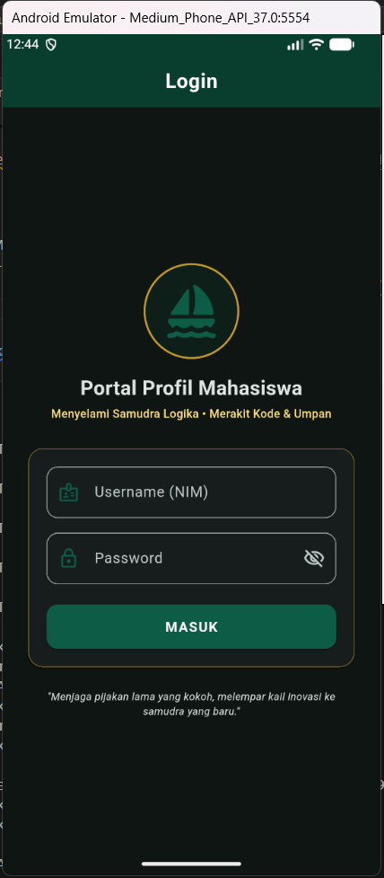
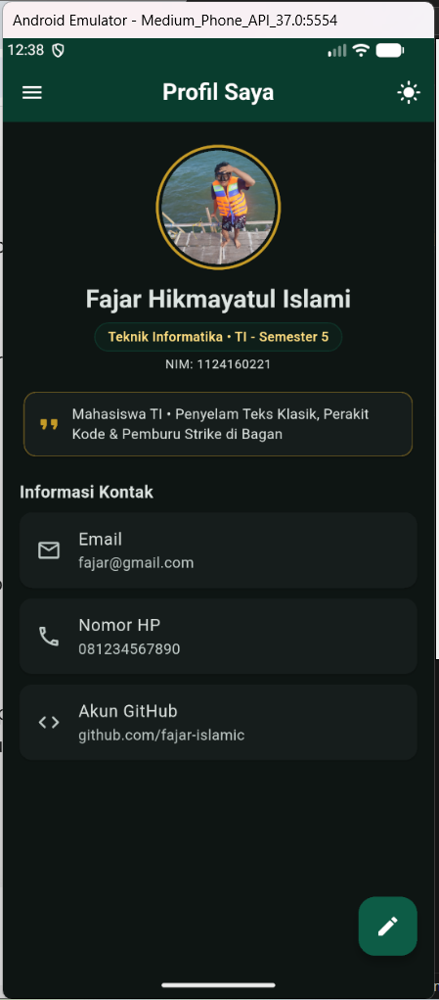
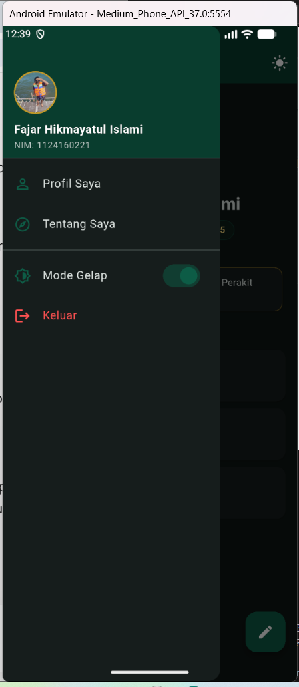
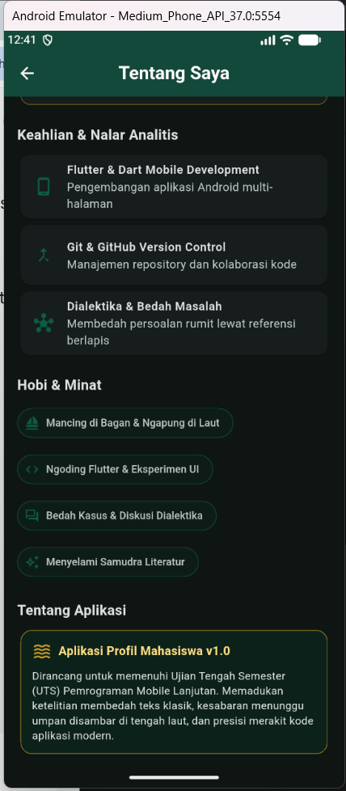
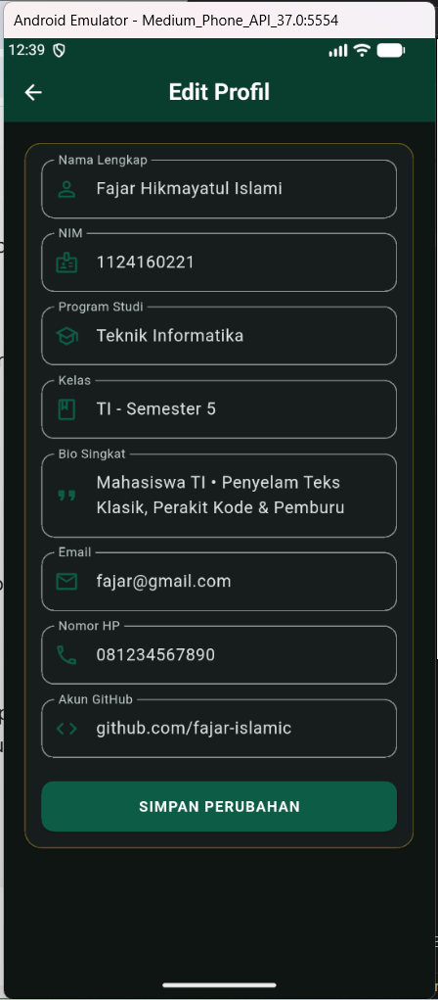

# UTS Pemrograman Mobile Lanjutan - Aplikasi Profil Mahasiswa

## Identitas Mahasiswa
* **Nama:** Fajar Hikmayatul Islami
* **NIM:** 1124160221
* **Kelas:** TI - Semester 5
* **Program Studi:** Teknik Informatika
* **Institusi:** Global Institute of Technology and Business

## Link Video Demo
* **Link YouTube:** [Tonton Video Demo Aplikasi Profil Fajar](https://youtu.be/QTynoJl0lo8?si=e0AHbn7lm8asQ7CC)

## Screenshot Aplikasi

| Halaman Login | Halaman Profil | Menu Drawer | Halaman Tentang Saya | Halaman Edit Profil |
| :---: | :---: | :---: | :---: | :---: |
|  |  |  |  |  |

## Penjelasan & Interpretasi Arsitektur Aplikasi

Aplikasi ini dibangun menggunakan framework **Flutter** dengan pendekatan arsitektur modular yang memisahkan antara model data (`models/`), antarmuka halaman (`screens/`), dan komponen antarmuka yang dapat digunakan ulang (`widgets/`).

### 1. Halaman Login (`login_page.dart`)
* **Validasi Input Terstruktur:** Menggunakan `Form` dan `GlobalKey<FormState>` untuk memvalidasi input *Username (NIM)* agar wajib diisi dan berformat angka, serta validasi *Password* minimal 6 karakter sebelum pengguna diizinkan masuk.
* **UX & Keamanan Visual:** Dilengkapi fitur sembunyikan/tampilkan kata sandi (`obscureText`) serta indikator proses memuat (`CircularProgressIndicator`) selama 1 detik sebelum berpindah halaman menggunakan `Navigator.pushReplacementNamed(context, '/profile')` agar pengguna tidak kembali ke halaman login saat menekan tombol kembali.

### 2. Halaman Profil & Navigasi Drawer (`profile_page.dart`)
* **Manajemen State Lokal (`StatefulWidget`):** Menyimpan objek data mahasiswa menggunakan model `Profile` dan memperbarui tampilan secara dinamis melalui fungsi `setState()` setiap kali terdapat perubahan data dari halaman edit.
* **Komponen Reusable (`InfoTile`):** Informasi kontak seperti Email, Nomor HP, dan akun GitHub ditampilkan menggunakan *custom widget* `InfoTile` agar struktur kode lebih bersih, konsisten, dan mudah dirawat.
* **Navigasi & Pengaturan Tema:** Menyediakan menu samping (`Drawer`) untuk berpindah antarhalaman (`Profil Saya`, `Tentang Saya`, `Keluar`) serta fitur sakelar **Mode Gelap (Dark Mode)** yang terhubung langsung ke tema utama aplikasi di `main.dart`.

### 3. Halaman Edit Profil (`edit_profile_page.dart`)
* **Pengelolaan Input Form:** Menggunakan `TextEditingController` yang diinisialisasi pada `initState()` dengan data profil saat ini sehingga pengguna dapat langsung menyunting bagian yang diinginkan tanpa mengetik ulang seluruh data.
* **Pengiriman Data Antarhalaman:** Setelah validasi `GlobalKey<FormState>` terpenuhi, objek `Profile` baru dikirim kembali ke `ProfilePage` menggunakan `Navigator.pop(context, dataBaru)`.

### 4. Halaman Tentang Saya (`about_page.dart`)
* **Tata Letak Gulir (`ListView`):** Menyusun informasi riwayat pendidikan, keahlian teknis, lencana hobi (`Wrap` & `Chip`), serta deskripsi aplikasi dalam daftar yang responsif pada berbagai ukuran layar perangkat Android.

## Cara Menjalankan Aplikasi
1. Clone repository ini ke komputer lokal:
   ```bash
   git clone [https://github.com/fajar-islamic/uts-pml-1124160221.git](https://github.com/fajar-islamic/uts-pml-1124160221.git)